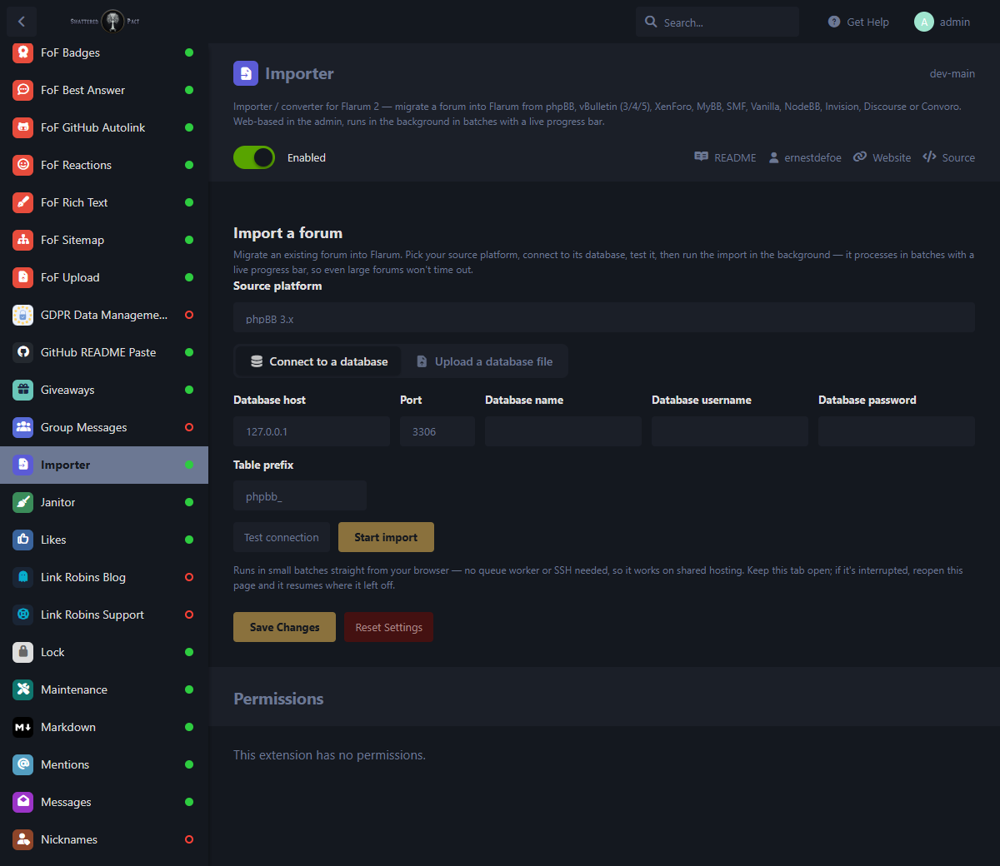
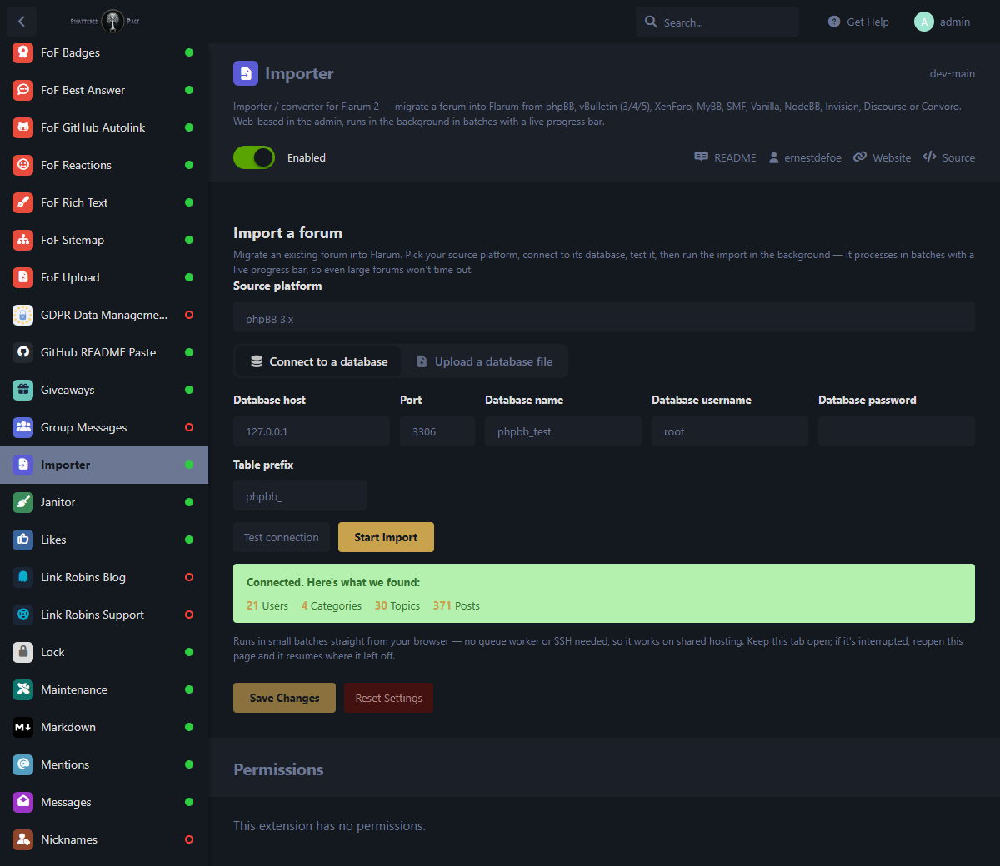
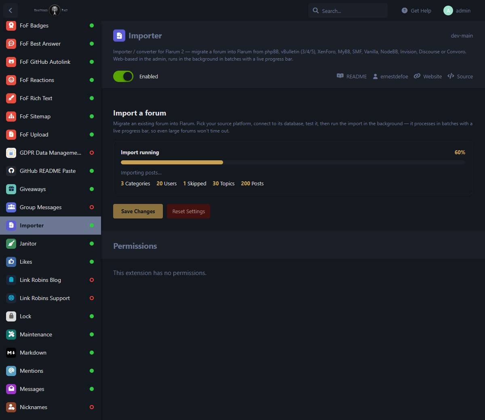
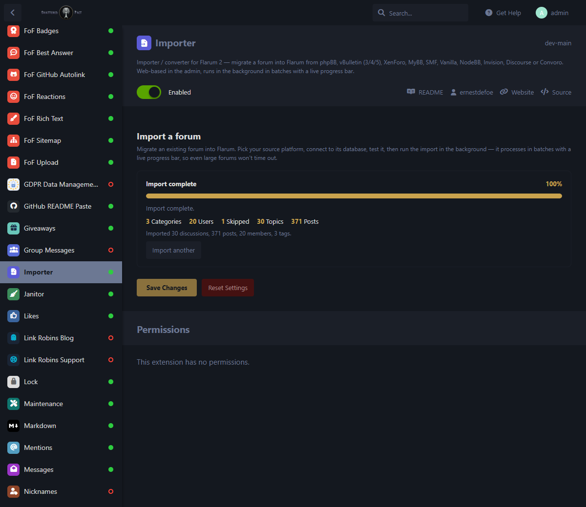

# Importer / Converter for Flarum 2

Migrate an existing forum into **Flarum 2** — from **phpBB, vBulletin (3/4/5), XenForo, MyBB, SMF, Vanilla, NodeBB, Invision, Discourse, Web Wiz Forums**, or **Convoro**. Everything is driven from the **admin panel**: pick a platform, connect to its database (or upload a dump), test it, then run the import in **small batches with a live progress bar** — so even a large forum won't time out.

> Ported from the Convoro importer suite. Members sign in with the password they already had, from every source except Web Wiz (see [Passwords](#passwords)). Every post and private message is written for **the editor your forum uses** — Markdown, BBCode, both, neither, or the Scribe WYSIWYG editor — so quotes, lists, code, spoilers, tables, colours and links come across as real formatting (see [Formatting](#formatting-whichever-editor-you-use)).

## Runs on shared hosting

No queue worker and no SSH required. The import runs as a loop of **small "step" requests straight from your browser**, each processing one bounded batch and returning — so it can never hit a web timeout. Progress and the source→Flarum id-maps are persisted in the database, so if the tab is closed or the connection drops, reopen the page and it **resumes exactly where it left off**. If you *do* have a queue worker (e.g. `fof/redis`), the import is handed to it and runs fully in the background instead — either way it's safe.

## The admin area

The whole tool lives on the extension's settings page.

### 1. The wizard

Pick a **source platform**, then either **connect to a database** (host, port, database name, username, password, and table prefix) or **upload a database file** (a `mysqldump` `.sql`/`.sql.gz`, or a SQLite file) for hosts that only hand you a dump. Nothing is written until you start.



### 2. Test the connection

**Test connection** validates the credentials, confirms it really is the platform you picked, then reports exactly what it found — here **21 Users, 4 Categories, 30 Topics, 371 Posts** — so you know it will pull the right data before committing. **Start import** only lights up once the test passes.



### 3. Watch it run

**Start import** kicks off the batched run and shows a **live progress bar** with the current phase and running totals — categories, members, topics and posts — updating as it goes.



When it finishes you get a summary of everything imported, and can start another.



## Supported sources

| Platform | Notes |
|----------|-------|
| phpBB 3.x | BBCode posts (3.0's escaped text and 3.2+'s stored XML) |
| vBulletin 3 / 4 · vBulletin 5 / 6 | one option covers both — vB5's node schema is auto-detected; "allow HTML" posts too |
| XenForo 1.x / 2.x | BBCode posts, including tables, spoilers, mentions and media |
| MyBB 1.8 · SMF 2.0 / 2.1 | BBCode posts |
| Vanilla · NodeBB | Vanilla's Html, BBCode, Markdown, Text, Rich and Rich2 formats; NodeBB's Markdown, from its Redis store (needs the `redis` PHP extension) |
| Invision Community (IP.Board) | HTML posts: quotes, spoilers, code, mentions, emoticons, embeds, uploads |
| Discourse | PostgreSQL source (needs `pdo_pgsql`); quotes, spoilers, onebox links, lightbox images |
| Web Wiz Forums | Microsoft SQL Server source. Connect directly where the host has `pdo_sqlsrv`, or **upload a script** generated by SSMS (*Generate Scripts → schema and data*) on any host |
| Convoro | Convoro → Flarum; bcrypt passwords copied, so members keep their logins |

Categories are imported as **tags** (requires `flarum/tags`); if tags aren't installed, discussions and posts still import, just untagged.

## How it works

- **Timeout-proof** — the run is a resumable state machine; each request processes one small batch and returns, so memory stays flat and nothing runs long enough to time out. Works with or without a queue worker.
- **Resumable** — progress, cursors and the source→Flarum id-maps live in the database, so a run survives a closed tab, a reload, or a dropped connection.
- **Faithful content** — every post is read from its board's own format and written for your forum's editor, then stored through Flarum's formatter, exactly as a post written on Flarum would be.
- **Relations preserved** — members, groups, tags, discussions, first/last-post pointers, comment counts and participant counts are all rebuilt.

## Formatting, whichever editor you use

A Flarum post is stored the way your forum's editor writes it, and what a forum can show depends on which formatting extensions it has. The importer looks at your forum before it writes anything — by asking Flarum's own formatter, not by guessing from extension names — and writes each post in the richest form that forum understands:

| Your forum has | Posts are written as |
|---|---|
| Markdown + BBCode (Flarum's default) | Markdown, with BBCode for what Markdown can't say (underline, colour, size, centring) |
| Markdown only | Markdown |
| BBCode only | BBCode, with quotes keeping their author natively |
| Neither | Clean plain text: line breaks, links and e-mail addresses still work |
| [Scribe](https://github.com/ernestdefoe/scribe) | Scribe's own HTML, so every post opens in the editor as if it had been typed there: tables, titled spoilers, colours, alignment, video embeds |

Another extension that adds a syntax (pipe tables, a `[spoiler]` BBCode…) is picked up automatically.

**What comes across, from every source that has it:** bold, italic, underline, strikethrough, superscript and subscript; headings; quotes, with who was quoted; bulleted, numbered and nested lists; code blocks with their language, and inline code; links and e-mail addresses; images; spoilers (with titles) and inline spoilers; tables; colour, size and alignment; YouTube and other video embeds; horizontal rules; smilies and emoji. Each board's own tags are understood — XenForo's `[QUOTE="Ada, post: 12, member: 3"]` and `[ISPOILER]`, vBulletin's `[QUOTE=Ada;12]` and `[ATTACH=JSON]`, phpBB's `<!-- m -->` links and `[b:uid]` tags, MyBB's `[align]`, SMF's `[quote author=…]`, Invision's `ipsQuote` and `ipsSpoiler`, Discourse's onebox previews and lightbox images, Vanilla's Rich and Rich2 JSON.

**Links between posts survive.** With `flarum/mentions` on, a mention of a member becomes a real mention (`@Ada`), a quote of another post opens with a link to that post, exactly as Flarum's own replies do, and a link to an old topic goes to its discussion here. Members and posts that weren't imported stay as their names.

**Nothing is dropped.** Where your forum has no way to show something, it is kept as readable text instead:

| On a forum without… | …this becomes |
|---|---|
| tables | one line per row, cells separated by `\|`, the header row bold |
| spoilers | a bold "Spoiler: title" line followed by the text (it is no longer hidden) |
| headings | a bold line |
| underline, colour, size, font, highlight | the words, unstyled |
| centring | the paragraph, unaligned |
| a quote author (Markdown, Scribe) | a bold "Ada wrote:" line in your forum's language |
| any formatting at all | plain text with `> ` before quoted lines and `•` before list items |

An attachment the importer can't copy (most boards keep files on disk, not in the database; vBulletin 5's are copied) stays as its file name, `[Attachment: photo.jpg]`, never a broken image. An image whose address only worked on the old board becomes its name too, unless you give the **old board's address** in the wizard, which also brings relative links and Invision/Discourse upload paths across. Text a member typed that looks like markup — `**`, `[b]`, `<b>` — stays exactly as typed.

### Switched editor after an import?

Imported posts are written for the editor the forum had **at the time**. If you change editor later (Markdown to Scribe, or turn BBCode on or off), rewrite them for the new one — the old board is not needed:

```bash
php flarum importer:reformat --dry-run   # counts and previews, saves nothing
php flarum importer:reformat             # imported posts and private messages, chunked, safe to run again
# --all          every post on the forum, not only imported ones
# --no-messages  leave private messages alone
# --markdown-text  imports made before 0.6.0 into a forum without Markdown left it as text (**bold**); read it as Markdown
```

A post somebody has written on the forum since is left alone unless you pass `--all`.

## Passwords

Members sign in with the password they had on the old board. A hash Flarum can check already (bcrypt of the password itself) is copied as it is; any other is kept apart from the member's Flarum password and checked the old board's way **at their first sign-in**, after which the password is saved the way Flarum saves passwords and the old hash is deleted. Setting a new password (a reset e-mail, the settings page) deletes the old hash too.

| Source | Old password kept |
|---|---|
| phpBB | 3.1+ bcrypt; 3.0 `$H$`; 3.3 argon2; phpBB 2 md5; converted `$CP$` hashes |
| XenForo | XF2 bcrypt; XF1 salted sha256/sha1; boards XenForo itself imported from vBulletin, phpBB, MyBB, IP.Board |
| vBulletin 3/4 | salted md5 |
| vBulletin 5/6 | `blowfish` and `argon2id` tokens, and accounts still on the `legacy` scheme |
| MyBB | salted md5, or bcrypt |
| SMF | 2.0 sha1 and 2.1 bcrypt |
| Invision | IPS 4 bcrypt and IP.Board 3 salted md5 |
| Discourse | PBKDF2, at whatever strength each account was saved with |
| Vanilla | bcrypt, phpass and Django-style hashes |
| NodeBB | bcrypt, including NodeBB's sha512-wrapped hashes |
| Convoro | bcrypt |
| Web Wiz | not kept: members use **Forgot password** |

🔒 An old hash on its own never signs anybody in. vBulletin 5's tokens, for instance, are bcrypt of the md5 of the password, so only the password itself is accepted, never its md5. Thanks to [Rob2dev](https://github.com/Rob2dev) for mapping vBulletin 5's password schemes on a real board ([#4](https://github.com/ernestdefoe/importer/pull/4)).

## Groups, profile photos, birthdays and attachments

| Platform | Groups | Profile photos | Birthdays | Attachments |
|----------|--------|----------------|-----------|-------------|
| phpBB 3.x | `groups` + `user_group` | uploaded (`images/avatars/upload`), remote, gallery, Gravatar | `user_birthday` | `attachments` (`files/`), placed where `[attachment=n]` was |
| XenForo 1.x / 2.x | `xf_user_group`, primary + secondary groups | uploaded (`data/avatars`), Gravatar | `xf_user_profile` | `xf_attachment` (`internal_data/attachments`), placed where `[ATTACH]` was |
| vBulletin 3 / 4 | `usergroup`, primary + `membergroupids` | `customavatar` (database or `customavatars/`), gallery | `user.birthday` | `attachment` / `filedata` (database or the attachments folder), placed where `[ATTACH]` was |
| vBulletin 5 / 6 | as vBulletin 3 / 4 (channel roles are permission sets, not groups) | as vBulletin 3 / 4 | `user.birthday` | Attach nodes + `filedata`, placed where `[ATTACH]` was |
| MyBB 1.8 | `usergroups`, primary + `additionalgroups` | uploaded (`uploads/avatars`), remote, Gravatar | `users.birthday` | `attachments` (`uploads/`), placed where `[attachment=n]` was |
| SMF 2.0 / 2.1 | `membergroups`, primary + `additional_groups` (post-count ranks are counted, not copied) | uploaded, gallery, remote | `members.birthdate` | `attachments` (the attachments folders), placed where `[attach id=n]` was |
| Vanilla | `Role` + `UserRole` | `User.Photo` (`uploads/userpics`) | `User.DateOfBirth` | `Media` (`uploads/`), and uploaded images in the posts |
| NodeBB | `group:*` sets | uploaded (`public/uploads/profile`) or remote | `birthday` | uploads linked in the posts (`public/uploads/files`) |
| Invision Community | `core_groups`, primary + `mgroup_others` | `pp_main_photo` (`uploads/`), Gravatar | `bday_*` | `core_attachments` (`uploads/`), placed where the post showed them |
| Discourse | `groups` + `group_users` (trust levels and staff are automatic, counted, not copied) | uploaded avatar (`public/uploads`) | `date_of_birth` (no year) | uploads in the post (`public/uploads`), short `upload://` links included |
| Web Wiz Forums | `tblGroup` (ladder groups are counted, not copied) | `Avatar` | `DOB` | uploads linked in the posts (`uploads/`) |
| Convoro | `groups` + `group_members` | with the member, as before | — (Convoro keeps none) | `attachments` (`content/attachments`), placed where the post showed them |

**Groups.** The old forum's administrators join Flarum's **Admin** group and its global moderators **Mod**; its registered-members and guest groups are Flarum's own Members and Guests. Every other group becomes a Flarum group of the same name and colour, with its members (a group with the same name already here is used instead). A new group has **no permissions** until you give it some in Admin → Permissions. Nothing is dropped silently: groups that are not groups of people on Flarum — banned members (they arrive suspended), members awaiting confirmation (they arrive unconfirmed), bots, automatic groups, post-count ranks and permission sets — are counted in the summary, with the reason. An account whose email nobody has confirmed is never made an Admin or Mod.

**Profile photos** are copied, never linked, and only onto a member with no picture yet. **Birthdays** need [Birthdays](https://github.com/datlechin/flarum-birthdays) (`datlechin/flarum-birthdays`) enabled; a birthday with no year keeps its day with the age hidden. Without the extension they are counted in the summary.

**Attachments** are copied onto this forum and shown where the post showed them; the rest are listed under the post, as the old forum listed them. With [FoF Upload](https://github.com/FriendsOfFlarum/upload) enabled each becomes one of its files (in its folder and media manager, tied to the post); otherwise it is a link to the copy. 🚨 A file is never stored in a form that can run: an image keeps the extension its content proves, a known document type keeps its own, and anything else (`.php`, `.html`, `.svg`, …) is stored as `.bin`, a download. A file that cannot be read keeps its name in the post and is counted in the summary. `[img]` images from other sites are left as they are.

**Where the files come from.** Most forums keep uploads on disk. Give the importer the **old forum's folder on this server** (the wizard's *Old forum's folder*, or `--files-path`): where it is installed, or a copy of it, outside this Flarum's own folder. Files are read only from that forum's upload folders, never its settings or scripts. Otherwise give its **address** (*Old forum's address*, `--assets-base`) while it is still online, and files are fetched from it. Files kept in the database (vBulletin) need neither.

```bash
php flarum importer:run --source=phpbb --database=my_old_forum --username=root --password=secret --prefix=phpbb_ \
  --files-path=/home/me/public_html/forum --assets-base=https://old.example.com/forum
```

**Already imported?** Run a sync: the first one brings every member's groups, photos and birthdays across, later ones only new members'. Attachments come with the posts a sync brings; posts imported before this version keep their attachment names.

## Private messages

Private messages come across too, into Flarum's own **Messages** (`flarum/messages`, bundled with Flarum 2), formatted for your editor exactly as posts are. They are on by default whenever Messages is enabled. Switch **Bring private messages across** off in the wizard, or pass `--no-private-messages` on the command line, to leave them behind. If Messages is not enabled, the import says so in its summary and moves on.

| Platform | Where they come from |
|----------|----------------------|
| phpBB 3.x | `privmsgs` + `privmsgs_to` |
| vBulletin 3 / 4 | `pmtext` + `pm` |
| vBulletin 5 / 6 | `privatemessage` nodes + `sentto` (system notifications and requests are left out) |
| XenForo 1.x / 2.x | `xf_conversation_master` + `xf_conversation_message` + `xf_conversation_recipient` |
| MyBB 1.8 | `privatemessages` (each member's copies are recognised as one message; drafts are left out) |
| SMF 2.0 / 2.1 | `personal_messages` + `pm_recipients` |
| Invision Community | `core_message_topics` + `core_message_posts` + `core_message_topic_user_map` (drafts are left out) |
| Discourse | personal-message topics, with `topic_allowed_users` and the members of `topic_allowed_groups` (messages the system sent itself, whispers and deleted posts are left out) |
| NodeBB | chat rooms and their messages (NodeBB 3's public chat channels are not private, so they are left out) |
| Vanilla | `Conversation` + `ConversationMessage` + `UserConversation` |
| Web Wiz Forums | `tblPMMessage` |
| Convoro | the messenger (Convoro 1.x and 2) |

How they land:

- **Two people:** the conversation between those two members in Messages, with every message in order and its original author and date. Flarum keeps one conversation per pair of members, so every old thread between the same two people ends up in it, in date order. Text is converted exactly as posts are. Flarum's direct messages have no titles, so old subjects are not kept for them.
- **Three or more people:** a group conversation, named after the old subject, when [Group Messages](https://github.com/ernestdefoe/group-messages) is installed and enabled. Without it they are **skipped and counted**: the summary says how many. They are never split into separate two-person conversations, because that would show people messages that were addressed to others as well. Install Group Messages later and run a sync: the skipped ones come across then.
- **Blind copies** (phpBB, vBulletin, MyBB, SMF): a member who was blind-copied gets the message in their own conversation with the sender, so the other recipients never see that they had it.
- **Deleted messages:** a message that every participant deleted is not imported, and nor is a draft. Messages has no way to hide one conversation from one member, so the closest thing is used instead: a member who deleted their copies of a conversation, or left it, is not added to it here. A member who kept any part of a two-person conversation sees all of it, because that is how Flarum shows a conversation.
- **Deleted accounts:** messages from members who were not imported show as written by a deleted member, exactly as their posts do. A deleted account is never added as a member.
- **Read and unread:** where the old forum recorded it, a message somebody had not read yet arrives unread for them. Everything else arrives read, so a whole history does not land as unread.
- **Privacy:** only the people in a conversation can see it. Nothing else on the forum shows it, and the import never logs or reports what a message says, only counts. Members are not notified when old messages arrive.

**Already imported before this version?** Run a sync and the messages come across: all of them the first time, then only new ones after that. A message is never brought across twice.

```bash
php flarum importer:run --sync --dry-run --password=secret   # counts them, saves nothing
php flarum importer:run --sync --password=secret
```

Or use **Sync new content** in the admin. For Vanilla, NodeBB and vBulletin 5, whose other content cannot be synced yet, a sync brings across the private messages only.

## Keeping the old forum in sync

Import once, then keep the old forum running while you set Flarum up, and sync as often as you like before you switch over. A sync copies only what the old forum has gained since the last run:

- **new members (with their groups, photos and birthdays), categories, discussions, replies (with their attachments) and private messages** — a reply in an old topic lands in the discussion that topic became, numbered after whatever is there now (including replies written on Flarum);
- **edits** made on the old forum, for phpBB, XenForo, MyBB, SMF and Invision (they record an edit time). An edit is only copied over a post nobody has edited on Flarum — if somebody has, the Flarum edit wins and the sync counts it as kept;
- the **counters** of whatever it touched: discussion reply counts and last posts, member post counts, tag counts. The old-link redirects pick up the new discussions on their own.

Nothing written on Flarum is changed or removed, and nothing deleted on the old forum is deleted here. Run it as many times as you like: what is already here is never copied twice.

**In the admin:** Admin → Importer shows **Keep the old forum in sync** once an import has finished (also on the finished-import screen). Click **Sync new content**, enter the old database's password again (it is never stored after a run), and click **Sync now**. An import made with 0.3.7 or earlier kept no connection settings, so the first time you fill in the same details as the import.

**From the command line:**

```bash
php flarum importer:run --sync --password=secret             # reuses the last import's settings
php flarum importer:run --sync --dry-run --password=secret   # counts what would come across, saves nothing
# an import made with 0.3.7 or earlier: give the connection once, as for the import
php flarum importer:run --sync --host=127.0.0.1 --database=my_old_forum --username=root --password=secret --prefix=phpbb_
```

Good to know:

- A sync reads only what is past the last thing it imported (plus a few hundred ids back, for posts and topics approved late), so it is quick. The **first** sync of an import made with 0.3.7 or earlier reads every post once, to learn which ones are already here.
- Only one import or sync runs at a time.
- Not yet for Vanilla, NodeBB or vBulletin 5, apart from their private messages (vBulletin 3/4 syncs new content, without edits; so do Discourse, Convoro and Web Wiz). Changes to members, titles or categories on the old forum, and deletions, are not synced.

## Requirements & tips

- Import into a **fresh Flarum** for the cleanest result.
- A queue worker is **optional** — the import runs from the browser without one. If you have `fof/redis` + a worker, it runs in the background instead.
- There's also a CLI for very large migrations or scripting:

```bash
php flarum importer:run --source=phpbb \
  --host=127.0.0.1 --database=my_old_forum --username=root --password=secret --prefix=phpbb_
# add --test to only check the connection and show counts
```

- Imported with 0.3.6 or earlier and see `<!-- m --><a class="postlink" …>` in old phpBB posts, or `&amp;` / `&lt;` where `&` and `<` should be? Repair them in place — the old board is not needed:

```bash
php flarum importer:repair-text --dry-run   # counts + a preview, saves nothing
php flarum importer:repair-text             # chunked, safe to run twice
# add --all if the import was reset in the wizard (only phpBB 3.0 markup is repaired then)
```

## Support

- **Support forum:** [Importer on ernestdefoe.online](https://ernestdefoe.online/d/75)
- **Flarum community:** [Importer on discuss.flarum.org](https://discuss.flarum.org/d/39527-importer)
- **Bug reports:** [GitHub issues](https://github.com/ernestdefoe/importer/issues)

## License

MIT © ernestdefoe
